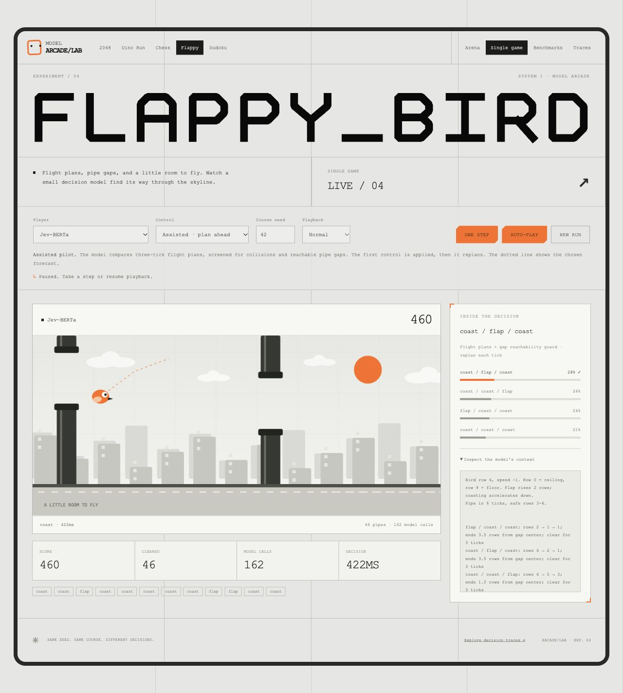
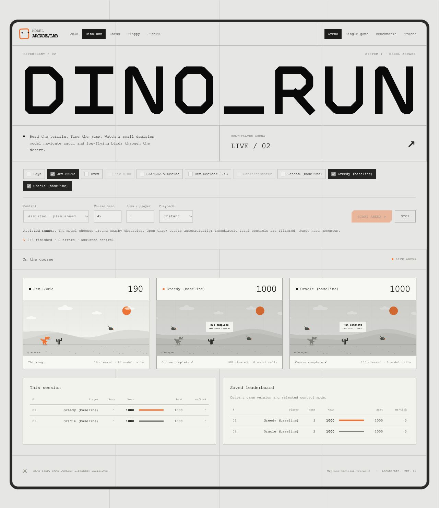
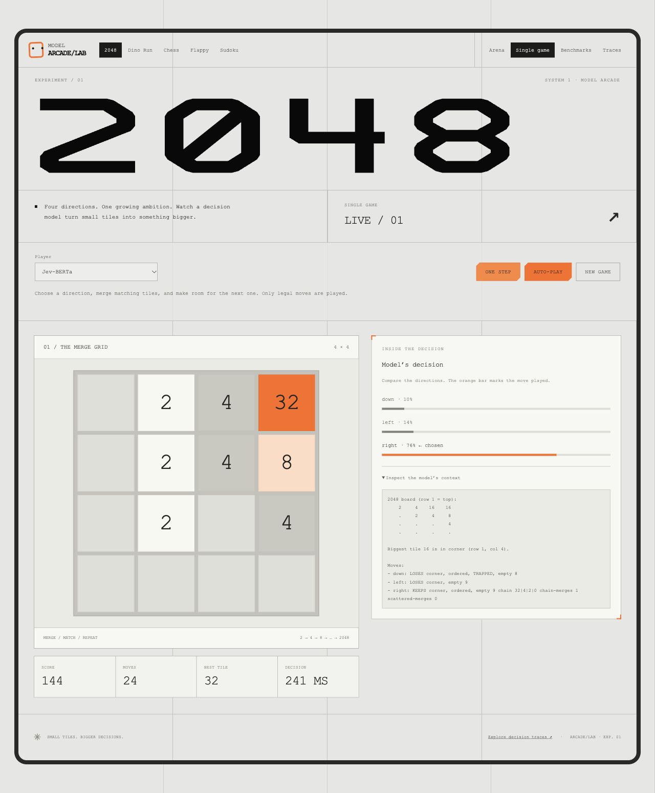
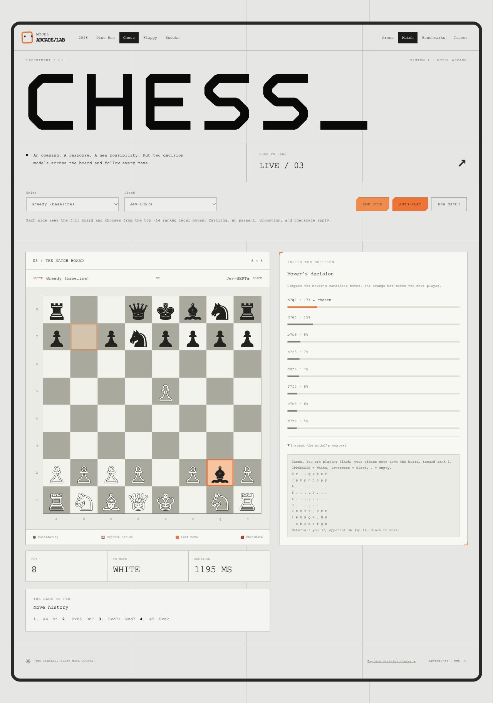
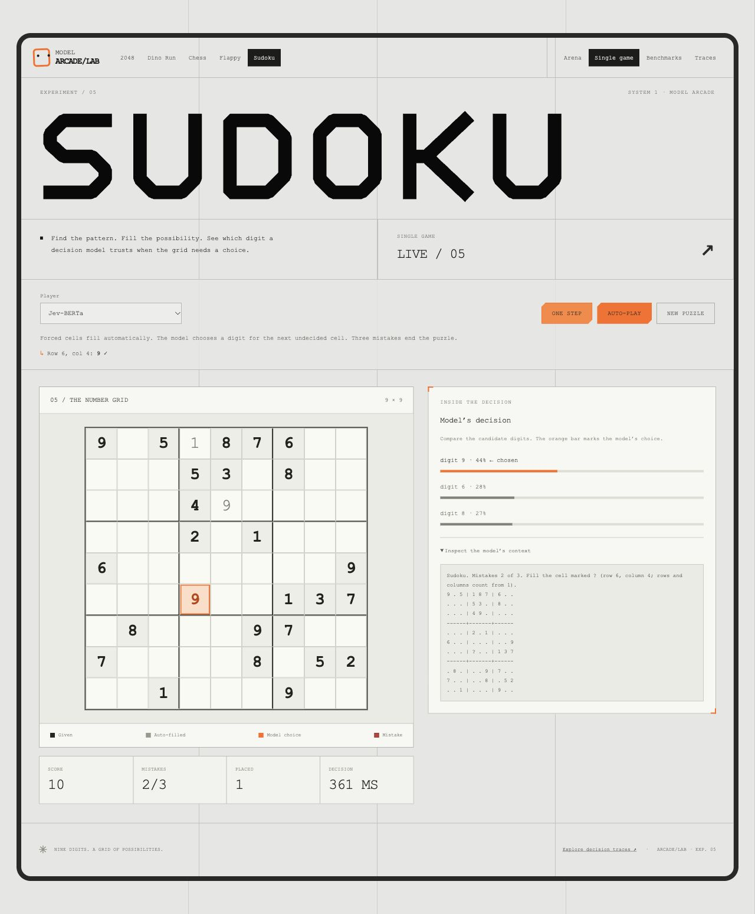
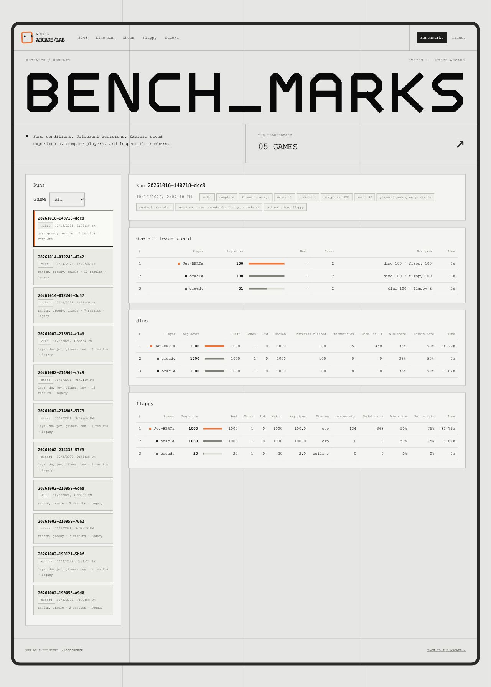
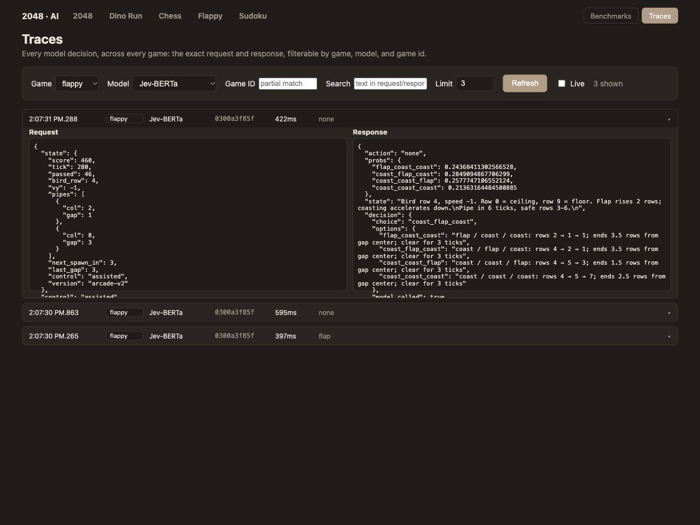

# Arcade games played by small decision models

Five games where the moves are chosen by a small **System 1 decision model** instead of a search
algorithm or an LLM: **2048**, a **Chrome-dino-style runner**, **Chess**, **Flappy Bird** and
**Sudoku**. Each turn the situation is described in text, the model picks one of the options, and
you watch it happen in the browser — alone, many at once to compare players (all five), or
head-to-head (Chess: two models play *each other*).

Seven models are supported (plus baseline players) and can be switched from the UI, in every game:

| Model | Package | Checkpoint | Size |
|---|---|---|---|
| **Laya** | [`laya`](https://pypi.org/project/laya/) | [`convaiinnovations/laya`](https://huggingface.co/convaiinnovations/laya) | ~420M |
| **Jev-BERTa** | [`jev-berta`](https://github.com/leobitz/jev-berta) | [`leobitz/jev-berta-base-zeroshot-classifier`](https://huggingface.co/leobitz/jev-berta-base-zeroshot-classifier) | ~198M |
| **Drex** | hosted API, [docs](https://drex.nace.ai/docs) | `drex-latest` (via `POST /v1/systemone`) | remote |
| **Kev-0.8B** | [github.com/jaredpalmer/kev](https://github.com/jaredpalmer/kev) (run yourself) | [`jaredpalmer/kev-0.8b`](https://huggingface.co/jaredpalmer/kev-0.8b) | ~0.8B |
| **GLiNER2.5-Decide** | [`gliner2`](https://pypi.org/project/gliner2/) | [`fastino/GLiNER2.5-Decide`](https://huggingface.co/fastino/GLiNER2.5-Decide) | ~340M |
| **Bev-Decider-0.4B** | [`bev-decider`](https://pypi.org/project/bev-decider/) | [`avbiswas/bev-decider-0.4B`](https://huggingface.co/avbiswas/bev-decider-0.4B) | ~0.4B |
| **DecisionMaster** | local package [`../decision-master`](../decision-master) | `leobitz/decision-master-base` (**gated** on the Hub) | Qwen3-based |

Laya, Jev, GLiNER, Bev and DecisionMaster are local, non-generative classifiers: they score a list of candidate
answers against a context and return probabilities. None of the seven was trained on any of these
games. Each is loaded **once** and shared between all five games (`models.py`), not duplicated
per game.

## Screenshots

A visual walkthrough of the running app. Expand any example; click an image or its full-size link to inspect the details. These are real browser captures, with live decisions and results from local runs.

<details open>
<summary><strong>Flappy Bird — a model chooses a flight plan</strong></summary>



Jev-BERTa in **assisted** mode: the dotted line previews the chosen flight plan, probability bars compare the options, and the expanded context shows the text and trajectories sent to the model. Score, pipes cleared, model calls, and latency remain visible.

[Open the full-size screenshot](docs/screenshots/flappy-decision.jpg).

</details>

<details>
<summary><strong>Dino Run — compare players on one seeded course</strong></summary>



Jev-BERTa, Greedy, and Oracle run side by side on **seed 42**. Each card shows its score, control, progress, and model-call count. Players advance at their own inference speed; the screenshot was taken while the model was still running and both baselines had finished.

[Open the full-size screenshot](docs/screenshots/dino-arena.jpg).

</details>

<details>
<summary><strong>2048 — inspect a move and its confidence</strong></summary>



The board, score, move count, and largest tile appear beside the chosen direction, per-option probabilities, and the exact board description used for the decision.

[Open the full-size screenshot](docs/screenshots/2048-decision.jpg).

</details>

<details>
<summary><strong>Chess — follow a head-to-head match</strong></summary>



Greedy plays White against Jev-BERTa as Black. The highlighted squares show the bishop capture just played; the right column shows the mover’s probabilities and board context, with move history below the board.

[Open the full-size screenshot](docs/screenshots/chess-match.jpg).

</details>

<details>
<summary><strong>Sudoku — see automatic fills and a model placement</strong></summary>



Jev-BERTa correctly chooses digit **9** for row 6, column 4, after two earlier mistakes. The orange target cell, candidate probabilities, model context, mistake counter, and differently styled given/auto-filled/model-placed cells explain what happened in that step.

[Open the full-size screenshot](docs/screenshots/sudoku-decision.jpg).

</details>

<details>
<summary><strong>Benchmarks — inspect a saved comparison</strong></summary>



A completed Dino + Flappy run shows its players, **seed 42**, **assisted** control, game versions, overall leaderboard, per-game scores, model calls, and decision timing. This screenshot uses one seed to demonstrate the interface; use more seeds for performance comparisons.

[Open the full-size screenshot](docs/screenshots/benchmark-results.jpg).

</details>

<details>
<summary><strong>Traces — inspect the exact request and response</strong></summary>



The trace browser is filtered to **Flappy / Jev-BERTa**, with one decision expanded. Request JSON, action probabilities, model context, selected flight plan, and latency can be inspected together. Live polling is paused to keep the view still.

[Open the full-size screenshot](docs/screenshots/decision-traces.jpg).

</details>

<details>
<summary><strong>Console — live progress and ranked results</strong></summary>

Run the guided launcher with `./benchmark`, or repeat the recorded comparison:

```bash
./benchmark --game dino,flappy --players jev greedy oracle --games 1 --seed 42
```

Actual console-output excerpts from that run, shown as text rather than a native Terminal screenshot:

```text
/ ·················· 0/3  5s elapsed  dino/jev · seed 42 · step 28 · score 20
```

```text
OVERALL LEADERBOARD · mean of per-game 0–100 points

#  player  overall  dino  flappy
-  ------  -------  ----  ------
1     jev    100.0   100     100
2  oracle    100.0   100     100
3  greedy     51.0   100       2
```

The live line reports completed games, elapsed time, player, seed, step, and score; an ETA appears after a game has completed. The final tables rank each game and the overall suite. This is a one-seed assisted demonstration, not an estimate of unaided model ability.

[Read the full console transcript](docs/screenshots/benchmark-output.txt).

</details>

Capture settings and reproduction steps are in [the screenshot guide](docs/screenshots/README.md).

## Quick start

For the public project/benchmark website, use the standalone [website folder](website/README.md):

```bash
cd website
docker compose up --build -d
```

The website defaults to <https://arcade.afroawi.com> behind host Nginx, with the app bound to `127.0.0.1:28481`. It reads benchmark folders, explains the project, accepts model/game suggestions into a persistent private review queue, and includes contribution and PR guides. Nginx/HTTPS setup and local HTTP overrides are documented in that folder. It runs independently of the model/game environment below. See [CONTRIBUTING.md](CONTRIBUTING.md) to add a model or a game with or without a browser UI.

Requires Python 3.10+. The server starts immediately; each local model loads on its first decision.
The first use of an uncached model downloads its checkpoint (which can take a few minutes).

```bash
python3 -m venv .venv && source .venv/bin/activate
pip install laya chess gliner2 peft bev-decider git+https://github.com/leobitz/jev-berta.git
# optional: DecisionMaster — see its section below (needs --no-deps and gated weights)
python server.py
```

Open <http://localhost:8048> — it redirects to the 2048 arena. Use the nav at the top of every
page to switch game (**2048** / **Dino Run** / **Chess** / **Flappy** / **Sudoku**) and mode:

| | Arena (many games/matches at once) | The other mode |
|---|---|---|
| **2048** | `/2048` | `/2048/play` — one move at a time |
| **Dino Run** | `/dino` | `/dino/play` — one obstacle at a time |
| **Chess** | `/chess` — every pair plays each other | `/chess/play` — pick White and Black, one ply at a time |
| **Flappy** | `/flappy` | `/flappy/play` — one tick at a time |
| **Sudoku** | `/sudoku` — every board gets the same puzzle | `/sudoku/play` — one decision at a time |

All five games share the same gray grid, geometric headings, sharp board cards, and orange controls in both modes. Single-game views pair the board with decision probabilities and an expandable model context; arenas show live cards and saved leaderboards.

There's also <http://localhost:8048/traces> — every model decision across all five games, with filters (see [Traces](#traces) below).

### Drex API key

Drex is a hosted API, so it needs a key (get one from the Drex dashboard). Copy `.env.example`
to `.env` and fill it in, then restart the server:

```bash
cp .env.example .env      # then set DREX_API_KEY=...
```

`.env` is git-ignored. Without a key, Drex appears greyed out with a hint and everything else works.
Optional: `DREX_MODEL` (default `drex-latest`) and `DREX_CONCURRENCY` (default 2, the free-tier limit; paid allows 16).
The client retries on 429/529 (honouring `retry-after-ms`). **Note:** state text is sent to Drex's servers.

### DecisionMaster (local package, gated weights)

`../decision-master` is a sibling checkout of a Qwen3-based model that scores a variable-size list
of candidates. `DecisionMasterBackend` uses its JEV-style `decide_jev()`, which takes the same
`(state, instructions, criteria)` shape as every other backend here. Three things to know:

- **Install without dependencies.** Its `pyproject.toml` pins `transformers<5`, but this project
  runs transformers 5.x for the other models. Its own test suite passes on 5.17, so install it
  with `--no-deps` rather than letting pip downgrade everything else:
  `pip install --no-deps -e ../decision-master`
- **The default Hub checkpoint is gated.** `leobitz/decision-master-base` returns a 401 unless your
  Hugging Face account has been granted access *and* you're authenticated — put `HF_TOKEN=...` in
  `.env` (or run `hf auth login`), or point `DECISION_MASTER_MODEL` at a local checkpoint directory
  (`config.json` + `model.safetensors` + tokenizer files). Until one of those is true it shows
  greyed out in every game with that reason, like an unconfigured Drex.
- **Verified with the real weights, benchmarked on two games so far.** With a token that has access,
  `leobitz/decision-master-base` (~1.1 GB) downloads and loads (CPU, float32), and it plays in every
  game. I first checked the integration against a tiny random-weight checkpoint while access was
  missing; the numbers in the [Flappy Bird](#flappy-bird) and [Sudoku](#sudoku) sections are from the
  real model. It hasn't been benchmarked on 2048, Dino Run or Chess.

### Kev (run it yourself)

Kev ([github.com/jaredpalmer/kev](https://github.com/jaredpalmer/kev)) is a small, openly-released
decision model you host and run locally — no hosted API, no key. It speaks the exact same
`/v1/systemone` contract as Drex, so `models.py`'s `KevBackend` is really a Drex client pointed at
`localhost` instead of a key. Two catches worth knowing before you set it up:

- The PyPI package literally named `kev` is **a different, unrelated project** (a boto3-based
  document store) — don't `pip install kev`. The real thing only exists as the GitHub repo above.
- Its `pyproject.toml` pins `torch>=2.6,<2.9`, which conflicts with this project's own torch (used
  by Laya/Jev). Give it a **separate venv**, not this project's `.venv`.
- The first run downloads a real checkpoint (the 0.8B base model + adapter), and Hugging Face's
  newer "Xet" CDN backend has repeatedly stalled at 0 bytes on large files here. Set
  `HF_HUB_DISABLE_XET=1` before running `kev.serve` (this project's own `.venv` sets it
  automatically for its own downloads — see Notes — but Kev's separate venv needs it set by hand).

```bash
git clone https://github.com/jaredpalmer/kev.git kev-repo && cd kev-repo
python3.13 -m venv .venv && source .venv/bin/activate   # a separate venv from this project's
pip install -e ".[serve]"                                # pulls in mlx-lm on Apple Silicon
HF_HUB_DISABLE_XET=1 python -m kev.serve --run jaredpalmer/kev-0.8b --port 8009
```

Leave that running in its own terminal (first run downloads the base model + adapter), then back
in this project's server it's picked up automatically — `KevBackend.availability()` just checks
whether `127.0.0.1:8009` is reachable. No `.env` entry is needed unless you changed the port/host
or started the Kev server with `KEV_API_KEY` (see `.env.example` for `KEV_URL`/`KEV_API_KEY`/
`KEV_MODEL`/`KEV_CONCURRENCY`). Without it running, Kev just appears greyed out like an unconfigured
Drex.

## Easy benchmarks

From this folder, run `./benchmark` for an interactive launcher. No activated venv is needed:
it uses this checkout's `.venv` automatically. `./benchmark --quick` runs a fast, seeded Dino + Flappy
baseline comparison with progress and ranked tables. Nothing new needs installing.

```bash
./benchmark                                      # guided setup in a terminal
./benchmark --quick                              # baselines, 3 identical seeds each
./benchmark --game dino,flappy --players jev greedy oracle --games 10
./benchmark --game all --players baselines --games 3 --max-plies 80
./benchmark --game flappy --players jev greedy --control raw --games 5
```

The console shows elapsed time, estimated time remaining, current player/seed/tick and score, then
per-game and overall leaderboards. Use `--json results/run.json --csv results/run.csv` to export;
`--plain` for log-friendly output; `--no-save` to keep the run out of the saved Benchmarks page.
All three competition formats still work. The old `bench_*.py` commands now use the same runner.
See [BENCHMARKING.md](BENCHMARKING.md) for options and interpretation.

## Running the benchmarks (headless, no browser)

> **Full guide: [BENCHMARKING.md](BENCHMARKING.md)** — the unified `benchmark.py` runner with competition formats
> (`average`, `versus`, `round-robin`) and multi-game suites with an overall leaderboard. The per-game scripts below
> are the simple way to run one comparison.

Each game has a small script that plays many games with no server and no browser — the quickest
way to compare players. Run them from the activated venv, from this directory:

| Script | What it does | Default players (no names given) |
|---|---|---|
| `bench.py` | Plays 2048 to the end, N times per player | `random`, `greedy`, `laya`, `jev` |
| `bench_dino.py` | Plays Dino Run to a crash or the cap, N times per player | `laya`, `jev`, `random`, `greedy`, `oracle` |
| `bench_chess.py` | Every pair of the given players plays once, alternating colors | `greedy`, `random` |
| `bench_flappy.py` | Plays Flappy Bird until a crash or the cap, N runs per player (run *i* uses seed *i*: identical pipes) | `laya`, `jev`, `random`, `greedy`, `oracle` |
| `bench_sudoku.py` | Solves N seeded puzzles per player (puzzle *i* from seed *i*: identical puzzles) | `laya`, `jev`, `random`, `greedy`, `oracle` |

```bash
python bench.py 8                    # 8 games each, default players
python bench.py 8 kev gliner bev     # 8 games each, only those three (random/greedy always included)
python bench_dino.py 5 gliner
python bench_chess.py 200 greedy random laya jev kev gliner bev   # every pair plays once, 200-ply cap
python bench_flappy.py 5 random greedy oracle gliner             # 5 runs on identical pipes
python bench_sudoku.py 10 greedy oracle laya dm                  # 10 identical puzzles
```

Player names: `laya`, `jev`, `drex`, `kev`, `gliner`, `bev`, `dm`, plus each game's own baselines (`random` and
`greedy` for 2048/Chess; `random` and `oracle` for Dino; `random`, `greedy` and `oracle` for Flappy/Sudoku). The first argument is always the game
count (2048/Dino) or the max-plies cutoff (Chess). These scripts check availability and use the same progress display as `benchmark.py`.
Unavailable backends are skipped. A player that fails mid-run is excluded from paired comparisons;
other players continue. Use `--fail-fast` on the unified runner to stop on the first error.

Results print as plain text to the terminal; the `bench_*.py` scripts also record each run to `bench_runs.jsonl` (see [Benchmark runs & the Benchmarks page](#benchmark-runs--the-benchmarks-page)). This is separate from
the Arena's saved `results_*.json` and the [Traces](#traces) log, which only capture games played
through the web UI.

## Arena: many games at once

Each game's Arena page runs several auto-play games (or, for Chess, matches) side by side and
compares players.

- **2048:** tick the players to include and set **games per player**; every game runs
  in parallel with a live mini board/track. **2048** starts every board in a run — every player,
  every repeat — from the same two starting tiles (regenerated fresh on each **Start**), so a lucky
  or unlucky opening doesn't decide the comparison.
- **Dino Run / Flappy Bird:** animated course cards, repeatable seeds, assisted/raw controls and
  adjustable playback speed. The world waits while a model thinks. Repeat *i* uses the same
  seed for every player.
- **Sudoku:** like 2048, every board in a run gets the **same puzzle** (one seed per **Start**), so
  a lucky puzzle can't favor a player. Boards advance as fast as the models answer — no fixed tick.
- **Chess:** tick 2+ players; every unordered pair plays **matches per pairing** games, alternating
  who's White, since color is a real advantage. There's no solo baseline run — it's inherently
  head-to-head.
- Tables update as games finish: **This run**, **All time (saved)**, and a top-10/recent-results list.
- Finished games are saved to `results_2048.json` / `results_dino.json` / `results_chess.json` on
  the server, so results survive restarts. **Stopped or unfinished games are not saved** — only a
  genuine finish (crash/checkmate/no legal move, or the move/obstacle/ply cap) is recorded. Delete
  a `results_*.json` file to reset it.
- ms/move (or ms/decision) is inflated when many games share one model, because calls to a model
  backend are queued (see Concurrency below). Use it as a rough comparison only.
- Dino/Flappy results are saved server-side on completion and identified by `arcade-v2` plus
  control mode, keeping older mechanics and raw/assisted leaderboards separate.
- The player list comes from the server (`GET /api/<game>/models`), so a newly registered model
  shows up on that game's pages automatically, with no UI changes.

## 2048

```
browser (JS game)  --grid + model-->  server.py  -->  engine2048.py  -->  models.py  -->  Laya / Jev / Drex
        ^                                                                     |
        +----------------------------- chosen move --------------------------+
```

1. **Guarded candidates.** `engine2048.candidates()` lists the legal moves and removes any that
   would pull the biggest tile out of its corner, unless that's the only option.
2. **State text.** `engine2048.describe()` renders the board and one terse line per candidate, e.g.
   `- left: KEEPS corner, ordered, empty 11 chain 64|64|0|0 chain-merges 1 scattered-merges 1 CORNER-MERGE-READY`.
3. **Decision.** The model answers "which move?" as a multiple-choice question over the candidates.
4. The browser applies the move, spawns a tile, and asks again.

**Strategy given to the model:** keep the biggest tile in a corner, line up the next-biggest along
the edge, grow the tile beside the corner until it equals it, then merge. The corner rule is
enforced in code (step 1); the rest is only described in the prompt.

**Benchmark** (`python bench.py 8`, headless, seeded games, small sample, CPU only):

| Player | Avg score | Typical best tile |
|---|---|---|
| random | ~690–1150 | 32–128 |
| Laya | ~1160 | 32–256 |
| Jev-BERTa | ~925 | 32–128 |
| Kev-0.8B | ~950 | 32–256 |
| GLiNER2.5-Decide | ~940 | 64–128 |
| Bev-Decider-0.4B | ~925 | 32–128 |
| greedy (merge score, then empty cells) | ~3340 | 256 |

**Honest takeaway:** all six models play at roughly random level, with Laya and Kev perhaps
slightly ahead. They can't plan ahead, and richer prompts made them *worse* — offering all four
directions plus per-move lookahead text (no code-enforced rules) scored much lower (Laya ~790, Jev
~645) and made them pick illegal directions 10-20% of the time, so that mode was reverted. What
helps is enforcing rules in code. A trivial greedy heuristic beats all six, so treat this as a
demo of wiring decision
models into a loop, not as a strong 2048 agent.

## Dino Run

**Desert sprint** (`/dino`, `/dino/play`) is an animated canvas runner: layered desert hills,
clouds, a pixel dinosaur, cacti and flapping birds. Real vertical collision bounds replace the old
obstacle/action lookup. A jump follows a five-tick arc (heights 2, 3, 3, 2, 0), and cannot be
cancelled; ducking reduces the grounded dinosaur's height. Cacti must be jumped, low birds ducked,
and high birds avoided by staying low. The course speeds up through shorter obstacle spacing.

- **Assisted** (default): open track coasts automatically, jumping again while airborne is not
  offered, and controls that would collide immediately are filtered when a safe choice exists.
  Near obstacles the model gets a concise physical description and chooses `jump`, `duck`, or `none`.
  Forced controls and idle ticks do **not** count as model calls.
- **Raw**: the model picks one of all three controls every tick, with no safety filtering.
- **Baselines:** random controls, a reactive greedy runner, and a physics-lookahead oracle.
- **Score:** 10 per obstacle cleared; runs finish on a collision, 100 obstacles, or 2400 ticks.

Both modes use server-authoritative state via `POST /api/dino/games` and
`POST /api/dino/games/<id>/step`. The browser only animates snapshots. The exact same Python
physics runs in headless benchmarks. Seed *i* is shared across players; subsequent repeats use
seed *i + 1*. Results include the seed, control mode, model-call count, and `arcade-v2` version.

The single-run page offers step, auto-play/pause, replayable course seeds and playback speed,
with the selected control, probabilities and model context alongside the scene. The arena runs
players side by side and saves finished runs once on the server; stopped runs are not scored.
Old grid-game scores are kept on disk but excluded from the new leaderboard.

## Chess

Real chess (via [`python-chess`](https://python-chess.readthedocs.io/)) — legal moves, castling,
en passant, promotion, check/checkmate and draw detection all apply. Unlike 2048/Dino, this game is
**adversarial**: two models play each other, alternating colors, so it's a genuinely different
architecture — see below.

```
browser (JS)  --{white, black}-->  server.py  --keeps the chess.Board per match-->  enginechess.py  -->  models.py  -->  Laya / Jev / Drex
     ^                                                                                    |
     +-------------------------------- move played this ply ---------------------------- +
```

- **Server-authoritative board.** 2048 mirrors its rules in JS so the browser can apply moves
  itself. Dino/Flappy now also keep authoritative state server-side. Chess's rules are too intricate to safely duplicate, so each
  match's `chess.Board` lives on the server (`server.py`'s `MATCHES`), and the browser just asks
  `POST /api/chess/matches/<id>/step` to play the next ply and render whatever FEN comes back.
- **Shortlisted candidates, like 2048's guarded mode.** A typical position has 20-40 legal moves;
  sending all of them (with a description each) risks blowing past the local models' ~512-token
  budget, and 2048 already showed that overwhelming the model with every option plays *worse* than
  a curated subset. `enginechess.shortlist()` ranks legal moves in code (captures by value, checks,
  checkmate, mild center pull, a small penalty for heading into a draw by repetition) and caps the
  list at 14 — the model still makes the final pick, just among good candidates rather than the
  full list. Two guards live purely in code, not the model's judgment: promoting to anything but a
  queen is never offered (it's legal but almost never correct, and just an extra way to blunder —
  the same "obviously-bad option, so don't offer it" idea as 2048's corner guard), and a move that
  would trigger a draw by repetition is deprioritized (not banned — genuine repetition, like
  perpetual check, is still available if nothing better exists). A busy midgame position runs ~300
  tokens total.
- **State text** names whose pieces are whose and which way they move, e.g. *"You are playing
  White; your pieces move up the board, toward rank 8. UPPERCASE = White, lowercase = Black"* — the
  full 8×8 grid follows, then each shortlisted move as `<SAN>: <tags>`, e.g. `Bxb5: captures pawn
  (+1), advances forward` or `O-O: castles kingside, king safety`.
- **Baselines:** `random` (uniform over *every* legal move, not just the shortlist) and `greedy`
  (always the top-ranked shortlisted move — captures/checks/center — no model involved).
- **On-board feedback:** while a side is deciding, the board shows a green dot on every candidate
  destination it's weighing (a red-ringed square instead if that candidate captures) — fetched via
  `GET /api/chess/matches/<id>/candidates`, which computes the shortlist without calling any model.
  The move actually played is then outlined; a checkmate outlines the whole board and the mated
  king's square in red. Both boards are 340px (Arena) / 600px (Match) so the Arena grid holds two
  per row.

**Benchmark:** `python bench_chess.py 200 greedy random laya jev kev gliner bev` plays every pair
once and prints a W/L/D tally (`200` = max plies before calling it a draw). No strong-play baseline is
included — building a real chess engine is out of scope here — so treat match results as "which
model reasons about a shortlisted position better than another," not absolute skill.

**Honest takeaway:** captures are real and render correctly (python-chess owns the rules; nothing
is faked), but "does it play with a strategy" has a mixed answer per model. Sampling 25 midgame
positions where a capture was available and code-ranked highest: **Jev-BERTa took it 24/25 times**,
**Greedy 25/25** (by construction), **random 2/25** (as expected), but **Laya took it only 6-9/25**
— it frequently passes on an objectively good, clearly-labeled capture. Left to play a full game,
Laya vs Jev tends to drift into repeated back-and-forth moves once material settles (now nudged
away from actual repetition by the shortlist penalty, but the underlying "no multi-move plan"
limitation remains) rather than building toward anything. **Kev-0.8B** was the pleasant surprise —
in one small run it beat Random by checkmate in 30 plies and drew Greedy — noticeably more coherent
here than in Dino Run, for whatever that's worth over such a small sample. **GLiNER2.5-Decide**
drew both Greedy (fivefold repetition) and Random (ply limit) in its own small run — competent
enough to avoid losing quickly, without forcing a decisive result either. **Bev-Decider-0.4B** also
drew both Greedy and Random on ply limits in its small run — like GLiNER, safe but not sharp here,
a contrast with its weaker Dino Run showing. Treat Chess like 2048 and Dino Run: a demo of wiring
decision models into a real, rules-correct game loop, not a strong chess engine.

## Flappy Bird

**Sky passage** (`/flappy`, `/flappy/play`) replaces the tile grid with an animated skyline,
solid pipes, a bird with visible climb/fall motion and a dotted forecast of its selected flight path.
The underlying discrete physics remain explicit: flap sets vertical speed to −2, gravity adds 1
up to +2, and the pipe gap is four rows tall. Touching a pipe, ceiling or floor ends the run.

- **Assisted** (default): the engine simulates the eight possible three-tick flap/coast sequences.
  It filters collisions and paths that leave no physically possible continuation through the
  **visible** pipe gaps. The model chooses among the remaining flight plans, guided by their
  predicted rows and distance from the gap center. Only the first control is applied; it replans
  next tick. The guard never uses future, unseen pipe spawns.
- **Raw**: the original `flap` / `none` choice every tick, with no trajectory filter.
- **Baselines:** random, a reactive greedy controller, and the exact-lookahead oracle. Baselines
  always use their own policy, regardless of the selected model-control mode.
- **Score:** 10 per pipe passed; 100-pipe / 2400-tick cap.

This is deliberately a model **plus a physics helper** in assisted mode. Its results do not measure
unaided model control and must be compared separately from raw mode and the old grid version.
Both the arena and CLI record the mode and `arcade-v2` version. The saved arena leaderboard
filters by both. Earlier README scores describe different mechanics and have been removed.

Like Dino, the server owns the state and seeded RNG (`POST /api/flappy/games`, then
`POST /api/flappy/games/<id>/step`); the browser renders it with no duplicated physics. You can
watch one decision at a time, inspect its options/context, pause, change playback speed, or compare
many players on identical seeded courses.

## Sudoku

Each step the engine **fills in every cell that has exactly one legal digit**, then asks the model
about the next cell that needs a real decision: *which digit goes here?*, among the digits still
legal there. A wrong digit is a **mistake** (it isn't placed, and is excluded from that cell next
time); **three mistakes end the game**. Score = 10 per correct decision, +100 for solving.

- **Puzzles** are generated from an integer seed with a **unique solution** (~25 givens). Because the
  seed picks the puzzle, an Arena run — or a benchmark — gives every player the identical puzzle.
  Fewer givens than the usual ~35 was deliberate: at 35, naked singles alone solved *every* puzzle, the
  model was never asked anything, and every player scored 100.
- **Which cell gets asked:** one that has a digit with nowhere else to go (so a pure deduction
  exists), otherwise the cell with the fewest candidates.
- **State text** is the board with the target cell marked `?`. Each option reads
  `5: other cells that can still take it — row 0, column 3, box 1`: a **0 means the digit has
  nowhere else to go in that row/column/box, so it must be the answer** (the instructions say so).
  That's a rule a model has to apply, not an answer handed over — which is exactly what's being measured.
- **Server-authoritative, like Chess:** the solution lives on the server and is never sent to the
  browser (`POST /api/sudoku/games`, then `POST /api/sudoku/games/<id>/step`). Auto-filled cells show
  grey, the model's correct placements orange, and a wrong guess highlights the target cell in red.

**Baselines:** `random` (a random legal digit), `greedy` (applies the "0 elsewhere" rule literally —
no model), `oracle` (reads the solution).

**Honest takeaway** (10 identical puzzles, `python bench_sudoku.py 10 …`):

| Player | Avg score | Solved | Avg mistakes | Avg correct decisions |
|---|---|---|---|---|
| random | 31.0 | 1/10 | 2.80 | 2.1 |
| Laya | 29.0 | 1/10 | 2.80 | 1.9 |
| Jev-BERTa | 55.0 | 2/10 | 2.80 | 3.5 |
| GLiNER2.5-Decide | 48.0 | 1/10 | 2.80 | 3.8 |
| Bev-Decider-0.4B | 1.0 | 0/10 | 3.00 | 0.1 |
| DecisionMaster | 26.0 | 1/10 | 2.90 | 1.6 |
| greedy | 230.0 | 10/10 | 0.60 | 13.0 |
| oracle | 236.0 | 10/10 | 0.00 | 13.6 |

**Every model is at or near random level**, while a ten-line rule that follows the instructions
solves all ten. The models aren't *applying the stated rule* — the information needed is in front of
them in each option. Bev is the worst (0.1 correct decisions per game: it nearly always loses its three
mistakes immediately). The tiny sample (10 puzzles) matters for the one-or-two-solves differences
between Jev, GLiNER, Laya and random, which aren't meaningful. Kev wasn't running for this benchmark.

## Traces

<http://localhost:8048/traces> logs and lets you browse **every** model decision, across all five
games, on its own page.

- **What's captured.** Each decision/step endpoint (including Dino/Flappy `/games/<id>/step`)
  appends one record: `game`, `model`, a `game_id` (2048/Dino: a random id the browser
  mints per game/run and sends along; Chess: the match id), the exact request and response bodies,
  and latency. It's server-side, so it captures Arena runs too, not just the single-game pages.
- **Storage:** `traces.jsonl` — one JSON object per line, append-only, git-ignored. A request
  returns at most 20,000 recent trace lines before applying filters.
- **Filters:** game, model, game id (partial match), and free-text search over the whole record
  (matches state text, a move, an error message, anything). Click a row to expand the full request
  and response JSON. **Live** (on by default) polls every 4 seconds.
- Errors are traced too (`response.error`), so it's a reasonable first stop when a model behaves
  oddly or a hosted call (Drex) fails.

## Concurrency

Local models (Laya, Jev) aren't safe to call concurrently, and Drex's free tier allows only 2
requests at once — `server.py` enforces this with one semaphore per backend, shared across all
five games (so any mix of arenas running at the same time still queue correctly behind one Laya
lock, not five).

**GPU-backed backends share one more lock.** Laya and Bev-Decider run on the Apple GPU (MPS).
Metal aborts the *entire process* — `failed assertion 'A command encoder is already encoding to
this command buffer'`, no Python traceback — if two threads use the GPU at once, and the
per-backend semaphores don't stop two *different* GPU models overlapping. A Sudoku Arena with
Laya and Bev ticked killed the server exactly that way. `models.GPU_LOCK` now serializes all
GPU-backed calls (DecisionMaster only when `DECISION_MASTER_DEVICE` puts it on a GPU). Verified by
running 14 games across 7 backends concurrently: 0 errors, server still up.

## Files

| File | Purpose |
|---|---|
| `models.py` | Shared model backends (Laya/Jev/Drex), cached by name and reused by all games |
| `engine2048.py` | 2048 rules, state description, move filtering, model-backed players |
| `enginedino.py` | Dino Run rules, state description, model-backed players |
| `enginechess.py` | Chess rules (via `python-chess`), move shortlisting, state description, model-backed players |
| `engineflappy.py` | Flappy Bird physics, state description, model-backed players, exact-DP oracle |
| `enginesudoku.py` | Sudoku generation (unique solutions, seeded), auto-fill, state description, model-backed players |
| `server.py` | HTTP server, pages, model availability, traces/results, Chess/Sudoku sessions, and Dino/Flappy `/games` sessions |
| `arena_2048.html` / `play_2048.html` | 2048 arena and single-game pages |
| `arena_dino.html` / `play_dino.html` | Dino Run arena and single-game pages |
| `arena_chess.html` / `play_chess.html` | Chess arena (round-robin) and one-match pages |
| `arena_flappy.html` / `play_flappy.html` | Flappy Bird arena and single-game pages |
| `arena_sudoku.html` / `play_sudoku.html` | Sudoku arena (same puzzle per run) and single-game pages |
| `style.css` | Shared base design |
| `arcade.css` | Shared design for all five games and the benchmark browser |
| `arcade.js` | Dino/Flappy animation and controls (no game physics) |
| `benchmark`, `benchmark_console.py` | Venv-aware launcher and dependency-free terminal progress dashboard |
| `tests/test_arcade.py` | Physics, model-control, API, persistence and benchmark regressions |
| `website/` | Standalone Docker Compose project/benchmark site, persistent model/game suggestions, and contribution guides |
| `.env.example` | Template for your API key (copy to `.env`) |
| `results_<game>.json` | Saved arena results per game (created on first finish, git-ignored) |
| `benchmark.py` | Unified headless runner: any game(s) × any players, with `average` / `versus` / `round-robin` formats and an overall leaderboard — see [BENCHMARKING.md](BENCHMARKING.md) |
| `runs.py`, `benchmarks.html` | Run grouping for saved bench results (`bench_runs.jsonl`) and the `/benchmarks` page |
| `bench.py` / `bench_dino.py` / `bench_chess.py` / `bench_flappy.py` / `bench_sudoku.py` | Headless benchmarks against each game's baselines |

## Notes

- **Jev on CPU:** the checkpoint contains half-precision layers, so `JevBackend` casts it to float32.
- **Jev batch size:** `jev-berta` chunks how many (state, candidate) rows it encodes in one
  forward pass per `predict()` call — `JEV_BATCH_SIZE` in `.env` (default 4). Matters most for
  Chess, which can offer up to 14 choices in a single call.
- **Laya warning:** loading prints a warning that the checkpoint has out-of-range temperatures.
  Its confidence values are uncalibrated; the choice probabilities are still usable for choosing.
- **Chess with exactly one legal move:** Jev-BERTa's `predict()` raises if given fewer than two
  choices, which a forced-move position (common near checkmate) would otherwise hit. `enginechess.
  Player.decide()` plays a single legal move directly without calling any backend, same as
  2048/Dino's "only one option" shortcuts.
- **GLiNER's public API only returns the winning label's confidence**, not a full distribution —
  `gliner2`'s `classify_text` normally reports just the argmax. `GlinerBackend` gets the full
  distribution anyway by passing the documented `multi_label=True, cls_threshold=0.0,
  class_act="softmax"` classification kwargs: every label clears the zero threshold, so the "which
  labels passed" list ends up being all of them, each with its true softmax probability.
- **Bev-Decider's `decide()` isn't wrapped in an `"answers"` key** the way Laya's `system_one()` is
  — it returns `{question_id: {...}}` directly. `BevBackend` accounts for this; worth knowing if
  you compare the two APIs directly, since they otherwise look identical (same typed-question shape).
- **Hugging Face downloads:** `models.py` sets `HF_HUB_DISABLE_XET=1` by default (a real env var
  still overrides it). HF's newer "Xet" CDN backend has repeatedly stalled at 0 bytes on large
  checkpoints here (hit this with both Kev's and Bev-Decider's weights) while the classic HTTP path
  downloads fine. This only covers downloads inside this project's own process — Kev runs as its
  own separate server/venv, so its README documents setting the same variable there too.
- **Adding a model:** add a `Backend` subclass in `models.py` implementing `answer(state,
  instructions, criteria)`, register it in `BACKENDS`, then in each game's engine call
  `model_player("your_name")` and add it to that game's `PLAYERS`. It appears on both of that
  game's pages automatically. A backend can opt out at runtime via `availability()` (Drex does
  this when no key is set).
- **Adding a game:** write `engine<name>.py` with a `Player` base class, `model_player()` built on
  `models.get_backend`, a `PLAYERS` dict and `get_player()`; add it to `GAMES` in `server.py`; add
  `arena_<name>.html` / `play_<name>.html` styled with `style.css`, and a nav entry linking to the
  other pages. Follow the server-authoritative pattern in Chess (`MATCHES`) or Dino/Flappy (`ARCADE`) so browser
  and headless runs share one engine.

## Benchmark runs & the Benchmarks page

Every headless bench (`bench.py`, `bench_dino.py`, `bench_chess.py`, `bench_flappy.py`, `bench_sudoku.py`)
creates one **run** (printed as `run <id>`) and saves each player's result under it in `bench_runs.jsonl`
(see `runs.py`). Open **http://localhost:8048/benchmarks** to browse runs, filter by game, and see each run
as a ranked table (score bars, game-specific columns; chess shows standings plus every game). The data is
also at `GET /api/benchmarks` and `GET /api/benchmarks/<run_id>`.

## Verification

Run `.venv/bin/python -B -m unittest discover -s tests -v` for the regression suite. It uses
local temporary result files and baseline/stub players; it does not download weights or call APIs.
The oracle regression checks 20 seeded, 100-obstacle/pipe courses for each updated arcade game.
