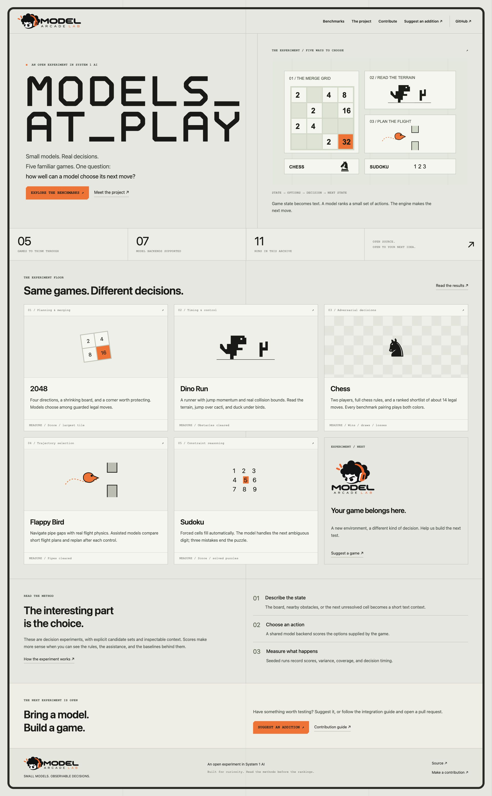
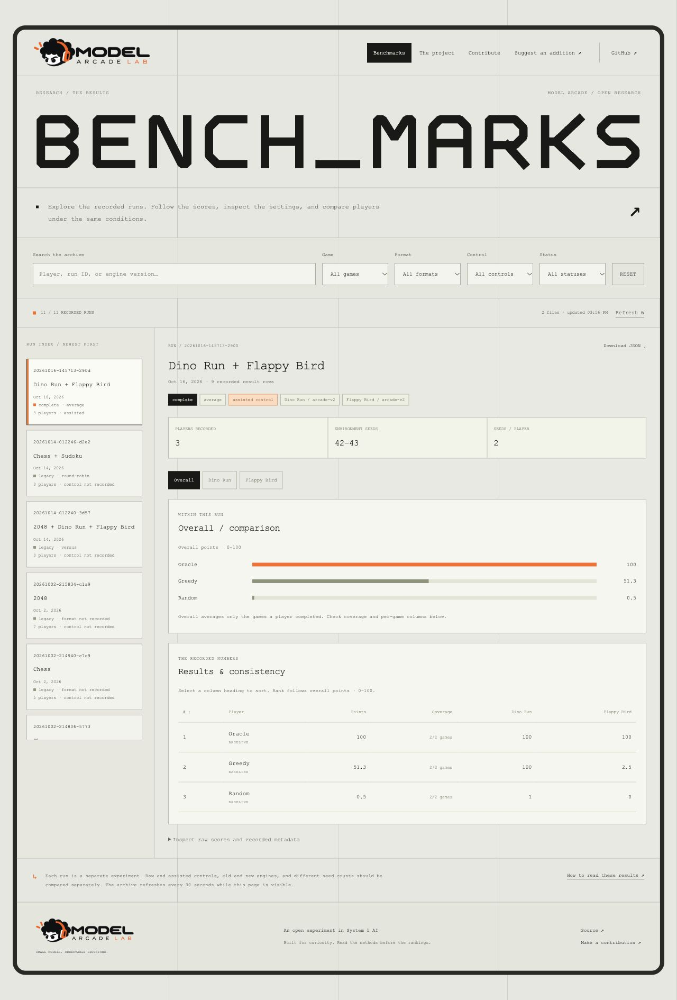
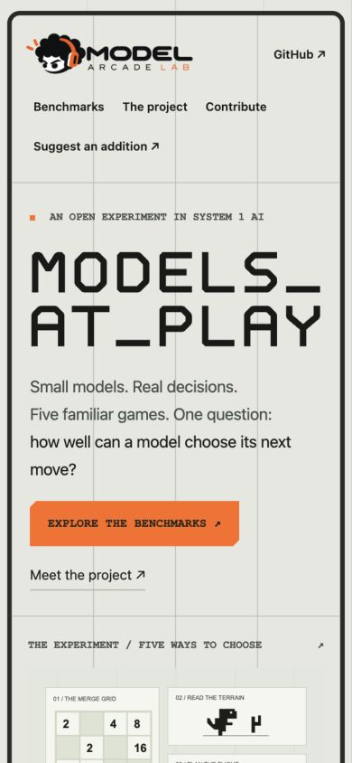

# Model Arcade Lab website

A standalone, self-hosted project and benchmark site. Uses the arcade's gray grid, geometric headings, and orange accents. It does **not** run game sessions, download model weights, or require the arcade's Python environment.

## Preview

Real browser captures of the Docker-hosted site at 1280 px desktop and 390 px mobile viewports, taken on 2026-10-16. The homepage uses an illustrative 2048 grid. The benchmark screenshot shows the actual two-seed baseline demonstration, with versions, control, seed range, coverage, and ranked results.

<details>
<summary>Homepage and project introduction</summary>



</details>

<details>
<summary>Benchmark archive and results explorer</summary>



</details>

<details>
<summary>Mobile layout with the supplied branding</summary>



</details>

## Brand assets

The site uses the supplied Model Arcade Lab artwork: the transparent horizontal logo in the shared header and footer, and the stacked logo on the homepage invitation card. The original PNGs are in `static/brand/`; they are copied without changing their pixels. CSS viewports remove their outer transparent margins while preserving the artwork's proportions.

`static/favicon.svg` displays the mascot from the same horizontal PNG through an SVG viewport. The original image is embedded so the browser icon has no external-image dependency. If replacing the logo, update both PNGs and the embedded favicon.

## Start

From the repository root:

```bash
cd website
docker compose up --build -d
```

The defaults target [https://arcade.afroawi.com](https://arcade.afroawi.com) behind the server's existing Nginx. Compose publishes **127.0.0.1:28481** to the container's internal port 8000, sets `PUBLIC_URL=https://arcade.afroawi.com`, and trusts one proxy. No `.env` is required for this deployment. Nginx must proxy that hostname to `http://127.0.0.1:28481` and terminate HTTPS; the base Compose service does not obtain certificates.

Docker Compose is the only dependency for the website container. The image installs the website's small, separate requirements and serves Flask through Gunicorn as a non-root user. Use **base Compose alone** with your existing Nginx; the optional Caddy overlay also binds public ports 80/443.

An existing `.env` or exported shell variable overrides these defaults. If you previously used the old defaults, update or remove `PORT=8080`, `PUBLIC_URL`, and `TRUST_PROXY=0` overrides before recreating the service. Preserve your benchmark-directory and other custom settings.

For direct local HTTP testing without Nginx:

```bash
PUBLIC_URL=http://localhost:28481 TRUST_PROXY=0 docker compose up --build -d
```

Then open [http://localhost:28481](http://localhost:28481). Keep these overrides when recreating the local service, or put them in a local `.env`. The HTTPS production defaults enable secure cookies and expect the production origin for form submissions.

```bash
docker compose logs -f web
docker compose ps
docker compose stop       # stop; preserve data
docker compose start     # resume
```

## Pages

| Page | Purpose |
|---|---|
| `/` | Project introduction, five games, current archive count, and contribution links |
| `/benchmarks` | Search/filter runs, compare charts, sort statistics, inspect chess matches and paired score matrices, and download JSON |
| `/project` | How decisions work, supported models, game-specific assistance, and how to interpret scores |
| `/submit` | Suggest a model with its source, creator, description, setup, license, and optional submitter handle |
| `/submit?kind=game` | Suggest a console-only game or UI + console game, with rules and integration notes |
| `/contribute` | Model, console game, browser game, testing, and pull-request contribution paths |
| `/healthz` | Application/database health for Compose and reverse proxies |

Suggestions are stored for **private maintainer review**. A successful submission shows a reference number and an optional link that prepares a public GitHub issue. The visitor chooses whether to publish that issue; very long suggestions are shortened in the prepared issue link, while their full contents remain in the private review queue. There is no automatic GitHub posting, email delivery, public suggestion feed, or automatic installation of submitted code.

## Read benchmark folders

The default read-only mount is `website/benchmark-data/` → `/benchmarks`. The reader recursively discovers:

- JSONL records from `bench_runs.jsonl`, including complete and interrupted runs.
- Full CLI exports created with `--json PATH` (`{run_id, records:[...]}`).
- Grouped run objects (`{run_id, game, params, ts, results:[...]}`).
- Arrays of those records or run objects.

It does not interpret Arena score files or CSV as benchmark runs. Limit: 500 files, 25 MiB per file. Symlinks outside the benchmark directory are skipped. A partially written final JSONL line does not hide earlier valid records; parse warnings appear in the archive.

Each run remains separate. The reader deduplicates overlapping logs/exports, retains repeated chess matches, and replaces checkpoints with final per-player results. Missing versions, control, or format are labeled explicitly. Overall standings show per-game coverage, including planned games that have no results.

### Publish an existing log

From `website/`:

```bash
python3 tools/import_benchmarks.py ../bench_runs.jsonl
# Multiple directories/files are supported:
python3 tools/import_benchmarks.py /path/to/benchmarks /path/to/another/run.json
```

This copies result files into the mounted directory. It needs only Python's standard library and skips unrelated JSON files. `bench_runs.jsonl` becomes `archive.jsonl`; same-name imports replace that local copy. Use separate subdirectories when importing folders whose relative filenames overlap.

### Export new runs directly

From the repository root, using the arcade's configured environment:

```bash
./benchmark --game dino,flappy --players jev greedy oracle \
  --games 10 --seed 42 \
  --json website/benchmark-data/comparison.json

./benchmark --game flappy --players jev greedy --control raw \
  --games 10 --json website/benchmark-data/flappy-raw.json
```

Files are discovered on the next API read. The archive refreshes every 30 seconds while visible, and has a manual Refresh button. No image rebuild is needed for new results. Use one export file per run to retain history.

For a different folder, copy `.env.example` to `.env`, set `BENCHMARK_DIR=/absolute/path/to/your/benchmarks`, then recreate the service:

```bash
docker compose up -d
```

The bind source must exist. Mount benchmark files only; do not mount a folder containing private configuration or credentials.

### Included data

`benchmark-data/archive.jsonl` is a snapshot of this repository's existing log, imported on 2026-10-16. Most records predate version/control metadata and are labeled legacy.

`benchmark-data/baseline-check.json` is a real two-seed interface demonstration produced on 2026-10-16 with:

```bash
./benchmark --quick --games 2 --seed 42 --no-save \
  --json website/benchmark-data/baseline-check.json --plain
```

It contains only Random, Greedy, and Oracle, with arcade-v2 Dino/Flappy. This small run demonstrates the site, not model performance. Add model comparisons and more seeds for research claims.

## Host with a domain and HTTPS

### Existing host Nginx (the default deployment)

Point `arcade.afroawi.com` to your server. Add its own server block to the existing Nginx configuration and proxy to `http://127.0.0.1:28481`, preserving `Host` and setting `X-Forwarded-For` to `$remote_addr` and `X-Forwarded-Proto` to `$scheme`. Obtain the domain's certificate on the host, validate Nginx, and reload it. With HTTPS configured, the base `docker compose up --build -d` command uses the matching public origin and secure cookies automatically.

For another domain, override `PUBLIC_URL=https://your-domain` and keep `TRUST_PROXY=1` when exactly one trusted proxy sits in front of the application. The public URL must match the browser origin for form submission. Subpath hosting is not configured; use a domain or subdomain.

### Optional Caddy on a host without an existing reverse proxy

Use this option on a host where public ports 80/443 are available. Point the domain's A/AAAA records to your server and allow inbound ports 80 and 443. Copy the environment template only if you do not already have a `.env`:

```bash
cp .env.example .env
```

Set `PUBLIC_DOMAIN` in `.env` to your real domain, without `https://` or a path. Then:

```bash
docker compose -f compose.yaml -f compose.https.yaml up --build -d
```

The optional Caddy service terminates HTTPS and proxies to `web:8000`. The overlay sets the public URL, secure session cookies, and trust for exactly one reverse proxy. Caddy's certificate/config volumes persist across restarts. DNS resolution and certificate issuance must be verified on your actual host; local checks do not establish that a public domain is deployed. See [Caddy's automatic HTTPS requirements](https://caddyserver.com/docs/automatic-https).

If you already run Nginx on this host, use the existing-proxy instructions above instead of starting Caddy.

## Review suggestions

The named `submissions` volume contains `/data/submissions.sqlite3`. Suggestions, review status, and the session-signing secret survive container replacement. There is no public admin endpoint; review from the host:

```bash
docker compose exec web python manage.py list
docker compose exec web python manage.py list --status pending
docker compose exec web python manage.py show ARC-YOURREFERENCE
docker compose exec web python manage.py status ARC-YOURREFERENCE in-review --note "Checking the adapter"
docker compose exec web python manage.py status ARC-YOURREFERENCE accepted
docker compose exec web python manage.py export --output /data/suggestions.json
docker compose cp web:/data/suggestions.json ./suggestions.json
```

Statuses: `pending`, `in-review`, `accepted`, `declined`, `implemented`. The reference is a receipt, not a publicly accessible status URL.

Form handling includes server-side field/URL validation, a 24 KiB request limit, session CSRF protection, an anti-bot field, duplicate detection, and a shared SQLite-backed rate limit (default five new suggestions per client IP per hour). IPs are HMAC fingerprints in the database; public web access logs follow Gunicorn's normal behavior. Configure `SUBMISSIONS_PER_HOUR` in `.env`.

### Back up the queue

Use the SQLite backup API to include a consistent snapshot even when WAL writes are active:

```bash
docker compose exec web python manage.py backup --output /data/queue-backup.sqlite3
docker compose cp web:/data/queue-backup.sqlite3 ./queue-backup.sqlite3
```

Choose a new backup filename each time. Keep backups private. `docker compose down` preserves named volumes; `docker compose down -v` removes them, including submissions. Before moving hosts, copy the benchmark folder and back up the queue; restore the database into the destination data volume with the service stopped and ownership UID/GID 10001.

## Configuration

| Variable | Default | Use |
|---|---|---|
| `PORT` | `28481` | Host HTTP port, bound to loopback by default |
| `HOST_BIND` | `127.0.0.1` | Interface exposed by the base Compose service |
| `BENCHMARK_DIR` | `./benchmark-data` | Host directory of public JSON/JSONL result files |
| `REPOSITORY_URL` | This project's GitHub repository | Source/fork/PR links and prepared issue links |
| `SUBMISSIONS_PER_HOUR` | `5` | New suggestions per client fingerprint per hour |
| `PUBLIC_DOMAIN` | Unset in base Compose; `arcade.afroawi.com` in the example | Required only by the optional Caddy overlay |
| `PUBLIC_URL` | `https://arcade.afroawi.com` | Public origin; also enables secure cookies for HTTPS |
| `TRUST_PROXY` | `1` | Trust one host reverse proxy; set to `0` for direct local HTTP testing |

The application's internal `DATA_DIR` defaults to `/data` in Docker. Do not share one SQLite database across separate physical hosts. The project assumes a single self-hosted instance with multiple Gunicorn workers.

## Checks

From `website/`:

```bash
docker compose config --quiet
PUBLIC_DOMAIN=benchmarks.example.com \
  docker compose -f compose.yaml -f compose.https.yaml config --quiet

docker compose run --rm --no-deps \
  -v "$PWD/tests:/app/tests:ro" web \
  python -m unittest discover -s tests -v
```

Tests use temporary databases, not the hosted queue. After editing source, rebuild with `docker compose up --build -d`. The browser assets are buildless; no Node or frontend build is needed to host. Source-based checks can mount the current directory as `/app:ro` to avoid rebuilding during backend development.

The app uses the production server pattern described in [Flask's Gunicorn guide](https://flask.palletsprojects.com/en/stable/deploying/gunicorn/). Live domain/TLS verification remains a hosting step.

## Layout

```text
website/
  compose.yaml / compose.https.yaml / Caddyfile
  Dockerfile / requirements.txt
  app.py / benchmarks.py / catalog.py / submissions.py
  manage.py
  templates/                 five public pages and receipt/error views
  static/                    shared CSS, SVG art, client scripts, favicon
  static/brand/              supplied horizontal and stacked logo PNGs
  benchmark-data/            mounted public benchmark files
  tools/import_benchmarks.py
  tests/test_website.py
```

The game engines and model code remain in the repository root. Contribution instructions are available on `/contribute` and in [CONTRIBUTING.md](../CONTRIBUTING.md).
